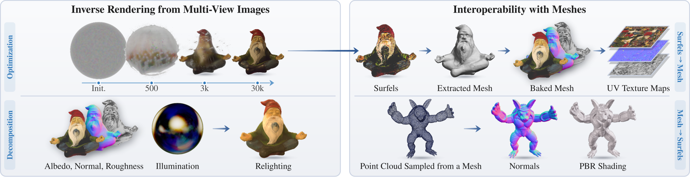
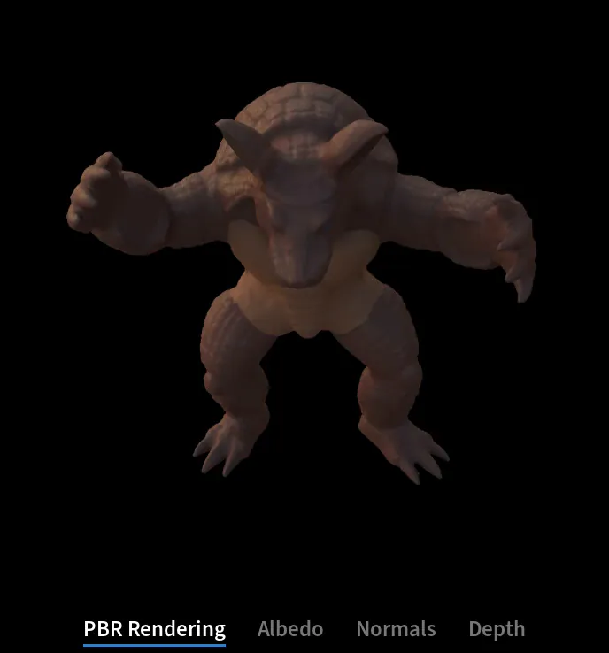
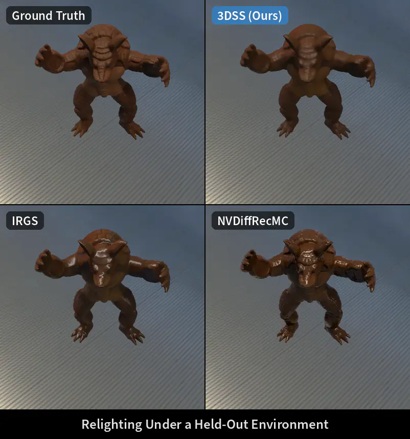
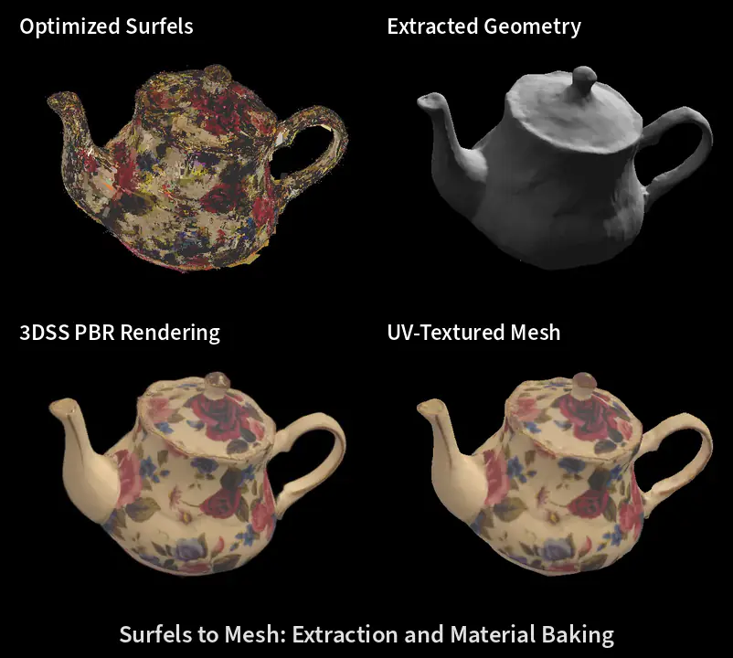
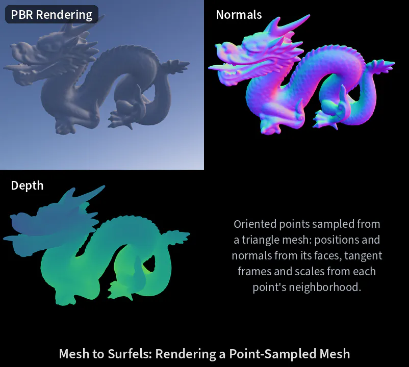
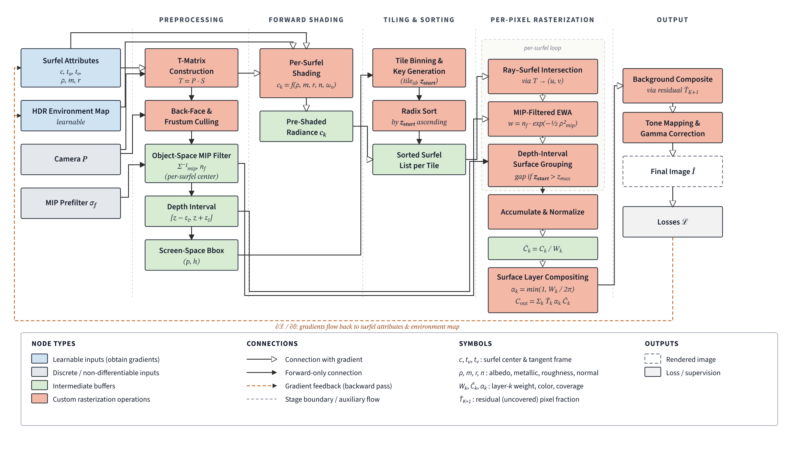

<div align="center">

# 3DSS: 3D Surface Splatting for Inverse Rendering

**[Mae Younes](https://maeyounes.github.io/)** &nbsp;&middot;&nbsp; **[Adnane Boukhayma](https://boukhayma.github.io/)**

INRIA, France

<a href="https://arxiv.org/abs/2605.05876"></a>
<a href="https://maeyounes.github.io/3DSS/"></a>


</div>

<p align="center">
  
</p>

<p align="center"><em>
3DSS recovers shape, materials, and illumination from multi-view images (left), and its surfels convert to and from triangle meshes (right).
</em></p>

## TL;DR

3DSS is the first differentiable surface splatting renderer for physically-based inverse rendering. Its oriented surfels need no connectivity, like points, yet render as opaque, anti-aliased surfaces, like meshes, and remain differentiable through visibility. From multi-view images, 3DSS jointly recovers shape, spatially-varying materials, and HDR environment lighting, and its optimized surfels convert directly into meshes with baked materials.

## Preview

<p align="center">
  
  
</p>

**Left:** one 3DSS model of the TensoIR Armadillo, swept through its PBR rendering, albedo, normals, and depth; all four channels come from the same optimized surfels.
**Right:** the recovered materials relit under an environment map not used during optimization, next to the ground truth, IRGS, and NVDiffRecMC.

<p align="center">
  
  
</p>

**Left:** from surfels to a mesh, on the Stanford-ORB Teapot. The optimized surfels (drawn here as flat disks in their albedo) form an oriented point cloud, which oriented-point surface reconstruction turns into a mesh; the surfel materials are then baked into UV texture maps. The 3DSS rendering and the UV-textured mesh are both shaded with direct light only.
**Right:** from a mesh to surfels. 3DSS renders oriented points sampled from a triangle mesh, here the Dragon, as an opaque, anti-aliased surface with physically-based shading.

More results are on the [project page](https://maeyounes.github.io/3DSS/).

## Abstract

We present *3D Surface Splatting* (3DSS), the first differentiable surface splatting renderer for physically-based inverse rendering from multi-view images. Our central insight is that surface separation, which groups the surfels covering a pixel by the surface they sample, can be formulated with the reconstruction kernels themselves: two surfels sample the same surface when their kernels overlap in depth. Compositing each resulting surface layer with a coverage opacity derived from its accumulated Elliptical Weighted Average (EWA) weight yields anti-aliased silhouettes and informative visibility gradients at sparsely covered edges. With forward microfacet shading under co-optimized HDR environment lighting, 3DSS jointly recovers shape, spatially-varying BRDF, and illumination, and its oriented surfels convert directly into meshes by oriented-point surface reconstruction. On the real-world Stanford-ORB and the TensoIR Synthetic benchmarks, 3DSS outperforms state-of-the-art mesh-based and major comparable implicit and Gaussian-based methods in novel view synthesis and relighting, with geometry on par with the strongest baselines.

<details>
<summary><b>Rendering Pipeline</b></summary>
<br>
<p align="center">
  
</p>

Each surfel is transformed to camera space, where its T-matrix gives the ray-surfel intersection and the screen-space bounding box. Surfels are shaded before rasterization, binned into screen-space tiles, and radix-sorted by the start of their depth interval. Each pixel then intersects its surfels, evaluates a MIP-filtered EWA kernel weight, merges overlapping depth intervals into surface layers, and composites the layers front to back with their coverage opacities. Gradients flow back through all these operations to the surfel parameters and the environment map.
</details>

## Code Release

The code will be released in this repository. We plan to release:

- [ ] The differentiable surfel rasterizer (CUDA)
- [ ] Inverse-rendering training scripts
- [ ] Mesh extraction and material baking tools
- [ ] Conversion of triangle meshes into surfels
- [ ] An interactive C++ renderer for surfel models

## Citation

If you find our work useful, please consider citing:

```bibtex
@article{younes20263dss,
  title={3DSS: 3D Surface Splatting for Inverse Rendering},
  author={Younes, Mae and Boukhayma, Adnane},
  journal={arXiv preprint arXiv:2605.05876},
  year={2026}
}
```

## License

The license will be announced together with the code.
